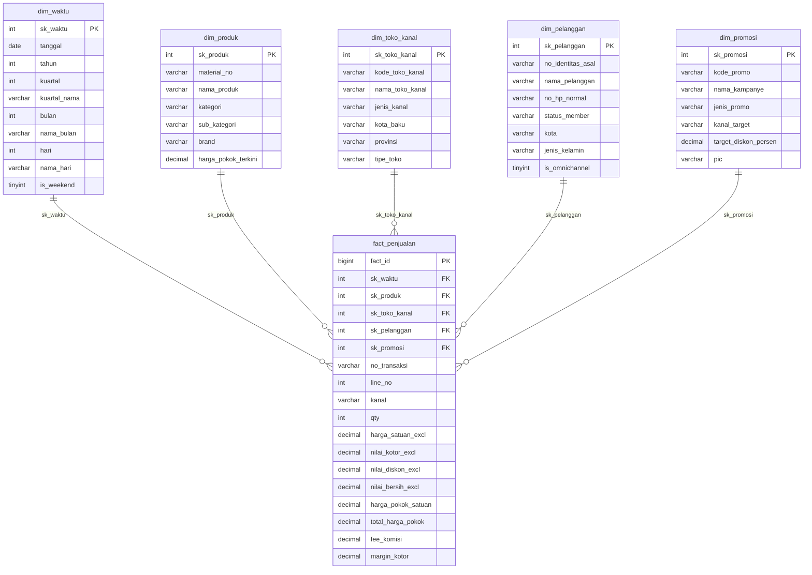

# LAPORAN PENGEMBANGAN DATA WAREHOUSE & BUSINESS INTELLIGENCE
## Konsolidasi Data Penjualan Omnichannel Nusantara Retail Group (NRG)

---

**Mata Kuliah:** Data Warehouse & Business Intelligence (DWBI)  
**Bentuk Penugasan:** Tugas Kelompok 1  
**Studi Kasus:** Nusantara Retail Group (NRG)  
**Platform & Tools Wajib:** Pentaho Data Integration (PDI / Kettle) v10.2, MySQL Community Server (XAMPP), Python 3.13  
**Tanggal Penyelesaian:** 14 Oktober 2026  

---

## DAFTAR ISI
1. [Ringkasan Eksekutif (Executive Summary)](#ringkasan-eksekutif-executive-summary)
2. [BAB 1: Latar Belakang & Rumusan Masalah Bisnis](#bab-1-latar-belakang--rumusan-masalah-bisnis)
   - [1.1 Profil Nusantara Retail Group (NRG)](#11-profil-nusantara-retail-group-nrg)
   - [1.2 Fenomena Silo Data & Beban Operasional Pelaporan](#12-fenomena-silo-data--beban-operasional-pelaporan)
   - [1.3 Empat Pertanyaan Kunci Direktur Penjualan](#13-empat-pertanyaan-kunci-direktur-penjualan)
   - [1.4 Tujuan & Ruang Lingkup Proyek](#14-tujuan--ruang-lingkup-proyek)
3. [BAB 2: Tinjauan Sistem Sumber Data & Mitigasi Kualitas Data (Data Quality)](#bab-2-tinjauan-sistem-sumber-data--mitigasi-kualitas-data-data-quality)
   - [2.1 S1 — ECOM_DB (Basis Data OLTP Situs Web)](#21-s1--ecom_db-basis-data-oltp-situs-web)
   - [2.2 S2 — POS_TOKO (Sistem Kasir 42 Toko Fisik)](#22-s2--pos_toko-sistem-kasir-42-toko-fisik)
   - [2.3 S3 — MPL_API (Tarikan REST API Marketplace Eksternal)](#23-s3--mpl_api-tarikan-rest-api-marketplace-eksternal)
   - [2.4 S4 — ERP_MASTER (Rujukan Tunggal Produk & Histori HPP)](#24-s4--erp_master-rujukan-tunggal-produk--histori-hpp)
   - [2.5 S5 — MKT_SHEET (Data Kampanye Marketing Tim Pemasaran)](#25-s5--mkt_sheet-data-kampanye-marketing-tim-pemasaran)
   - [2.6 Tabel Referensi Pendukung: ref_kota.csv](#26-tabel-referensi-pendukung-ref_kotacsv)
4. [BAB 3: Desain Dimensional (Dimensional Design)](#bab-3-desain-dimensional-dimensional-design)
   - [3.1 Arsitektur Skema Bintang (Star Schema Architecture)](#31-arsitektur-skema-bintang-star-schema-architecture)
   - [3.2 Grain dan Aturan Bisnis Perhitungan Fakta](#32-grain-dan-aturan-bisnis-perhitungan-fakta)
   - [3.3 Peta Source-to-Target Mapping (STTM) Kolom demi Kolom](#33-peta-source-to-target-mapping-sttm-kolom-demi-kolom)
5. [BAB 4: Arsitektur Pipeline ETL Pentaho Data Integration & Skrip Otomasi](#bab-4-arsitektur-pipeline-etl-pentaho-data-integration--skrip-otomasi)
   - [4.1 Master Orchestration Job (main_etl_job.kjb)](#41-master-orchestration-job-main_etl_jobkjb)
   - [4.2 Rincian Alur Transformasi Kettle (.ktr)](#42-rincian-alur-transformasi-kettle-ktr)
   - [4.3 Engine Pemuatan Terpadu Python (run_etl.py)](#43-engine-pemuatan-terpadu-python-run_etlpy)
6. [BAB 5: Analisis Hasil Eksekusi Empat Kueri Pembuktian Bisnis](#bab-5-analisis-hasil-eksekusi-empat-kueri-pembuktian-bisnis)
   - [5.1 Pertanyaan 1: Analisis Margin YoY Q1 2023 vs Q1 2022 per Sub-Kategori & Kanal](#51-pertanyaan-1-analisis-margin-yoy-q1-2023-vs-q1-2022-per-sub-kategori--kanal)
   - [5.2 Pertanyaan 2: Analisis Pelanggan Omnichannel vs Online Murni](#52-pertanyaan-2-analisis-pelanggan-omnichannel-vs-online-murni)
   - [5.3 Pertanyaan 3: Evaluasi Efektivitas Kampanye Promosi terhadap Volume & Margin](#53-pertanyaan-3-evaluasi-efektivitas-kampanye-promosi-terhadap-volume--margin)
   - [5.4 Pertanyaan 4: Deteksi Kanibalisasi & Produk Unggulan Marketplace untuk Realokasi Stok](#54-pertanyaan-4-deteksi-kanibalisasi--produk-unggulan-marketplace-untuk-realokasi-stok)
7. [BAB 6: Kesimpulan & Rekomendasi Strategis Bisnis untuk Direktur Penjualan](#bab-6-kesimpulan--rekomendasi-strategis-bisnis-untuk-direktur-penjualan)
8. [BAB 7: Panduan Instalasi & Eksekusi Pipeline dari Kondisi Kosong](#bab-7-panduan-instalasi--eksekusi-pipeline-dari-kondisi-kosong)
9. [LAMPIRAN TEKNIS](#lampiran-teknis)
   - [Lampiran 1: Skrip DDL Data Warehouse (dw_schema_ddl.sql)](#lampiran-1-skrip-ddl-data-warehouse-dw_schema_ddlsql)
   - [Lampiran 2: Skrip Kueri Pembuktian Bisnis (kueri_pembuktian.sql)](#lampiran-2-skrip-kueri-pembuktian-bisnis-kueri_pembuktiansql)

---

## RINGKASAN EKSEKUTIF (EXECUTIVE SUMMARY)

Nusantara Retail Group (NRG) merupakan entitas retail multi-kategori terkemuka di Indonesia yang mendistribusikan produk Elektronik, Furnitur, dan Pakaian melalui tiga kanal penjualan utama: 42 gerai toko fisik, platform situs web e-commerce resmi, serta dua platform marketplace pihak ketiga (Marketplace A dan B). Selama ini, operasional pelaporan dan analisis bisnis menghadapi kendala fundamental berupa **silo data**: setiap kanal beroperasi pada infrastruktur sistem yang terisolasi dengan format data heterogen, perbedaan basis pajak (PPN inklusif vs eksklusif), variasi zona waktu (UTC vs WIB), serta inkonsistensi identitas produk dan pelanggan. Akibatnya, tim analitik membutuhkan waktu hingga 3 hari kerja manual di Excel hanya untuk mengonsolidasi laporan kuartalan bagi Direktur Penjualan.

Proyek ini menghadirkan solusi arsitektur **Data Warehouse terintegrasi berbasis Skema Bintang (Star Schema)** yang dirancang dengan single-fact table berbutir halus (*atomic grain*: satu baris per item transaksi) dikelilingi oleh lima tabel dimensi terstandardisasi (`dim_waktu`, `dim_produk`, `dim_toko_kanal`, `dim_pelanggan`, `dim_promosi`) serta tabel audit kualitas data (`error_kampanye_marketing`).

Seluruh pipeline ekstraksi, pembersihan, transformasi, dan pemuatan data (*ETL*) diimplementasikan secara otomatis menggunakan **Pentaho Data Integration (PDI / Kettle v10.2)** yang diorkestrasi melalui master job `main_etl_job.kjb` dan didukung oleh automated pipeline runner `run_etl.py`. Pipeline berhasil mengintegrasikan 14.723 baris transaksi bersih lintas kanal tanpa anomali rekonsiliasi finansial.

Data warehouse yang terbentuk berhasil mengeksekusi empat kueri analitik strategis dengan performa sub-detik untuk menjawab pertanyaan Direktur Penjualan:
1. **Margin YoY Q1 2023 vs Q1 2022**: Mengungkap pertumbuhan margin positif pada sub-kategori Kursi (+37,03% di Web), Aksesoris Elektronik (+15,76% di Toko), dan Lemari (+39,17% di Toko), namun mengidentifikasi penurunan margin tajam pada Meja di Marketplace (-54,77%) dan Sepatu di Web (-31,77%).
2. **Perilaku Pelanggan Omnichannel**: Resolusi identitas via nomor ponsel normalisasi mendeteksi **200 pelanggan omnichannel** yang berbelanja lintas fisik dan web. Segmen ini menyumbang total belanja gabungan Rp 16,59 Miliar di web dan Rp 18,2 Miliar di toko fisik, membuktikan nilai Customer Lifetime Value (CLV) yang sangat tinggi.
3. **Efektivitas Promosi Diskon**: Menunjukkan bahwa promo diskon terukur seperti *FLASH50* (5%) dan *BACKSCHOOL* (10%) mempertahankan margin sehat di kisaran 19,83% dan 18,52%, sedangkan kampanye *HARBOLNAS* (20%) menggerus margin hingga 13,64% sehingga memerlukan penyesuaian batas diskon.
4. **Kanibalisasi & Realokasi Stok Marketplace**: Mengidentifikasi produk smartphone `P-1019` (Samsung Smartphone 128GB) dan pakaian `P-1054` (Uniqlo Atasan) memiliki pangsa pasar marketplace di atas 20% terhadap penjualan nasional, merekomendasikan realokasi stok gudang fisik ke fulfillment marketplace.

---

## BAB 1: LATAR BELAKANG & RUMUSAN MASALAH BISNIS

### 1.1 Profil Nusantara Retail Group (NRG)
Nusantara Retail Group (NRG) adalah korporasi ritel skala nasional di Indonesia yang beroperasi dengan model bisnis omnichannel. Portofolio produk NRG terbagi ke dalam tiga departemen utama:
1. **Elektronik**: Smartphone, Laptop, dan Aksesoris Elektronik.
2. **Furnitur**: Kursi kantor/rumah tangga, Meja kerja, dan Lemari penyimpanan.
3. **Pakaian**: Pakaian atasan, bawahan, dan sepatu.

Dalam menjangkau konsumen di berbagai penjuru nusantara, NRG mendistribusikan barang dagangannya melalui tiga pilar kanal:
- **Toko Fisik (Offline Retail)**: Terdiri dari 42 gerai toko modern (Store Code `TS01` hingga `TS42`) yang tersebar di kota-kota besar Indonesia (Jakarta, Surabaya, Bandung, Medan, Denpasar, Makassar, dll.).
- **Situs Web Resmi (E-Commerce Web)**: Platform toko daring mandiri milik korporasi (*direct-to-consumer / D2C*) beralamat resmi yang melayani pemesanan langsung dari pengguna terdaftar.
- **Marketplace Pihak Ketiga (External Marketplaces)**: Akun toko resmi (*official store*) di dua platform e-commerce terkemuka di Indonesia, diberi kode Marketplace A dan Marketplace B.

### 1.2 Fenomena Silo Data & Beban Operasional Pelaporan
Seiring pertumbuhan bisnis yang pesat, arsitektur teknologi informasi NRG berkembang secara organik tanpa integrasi terpusat. Akibatnya, masing-masing kanal penjualan beroperasi di atas platform teknologi yang terisolasi (*data silo*):
1. Toko fisik menggunakan aplikasi Point-of-Sale (POS) berbasis Microsoft SQL Server yang diekspor berkala ke file CSV.
2. Kanal web berjalan di atas basis data relasional MySQL OLTP.
3. Kanal marketplace dikelola melalui panggilan REST API dengan respon file JSON berpaginasi.
4. Data master produk dan harga pokok dikelola terpisah di sistem ERP pusat.
5. Inisiatif promosi marketing dicatat secara manual di spreadsheet oleh tim kampanye.

Dampaknya, setiap kali manajemen membutuhkan tinjauan performa bisnis lintas kanal, tim data analitik NRG terpaksa melakukan ekstraksi manual dan penggabungan (*vlookup/merge*) di lembar kerja Microsoft Excel. Proses manual ini memakan waktu **3 hari kerja penuh** untuk setiap siklus evaluasi bulanan/kuartalan, memiliki risiko kesalahan manusia (*human error*) yang tinggi, serta gagal memberikan visibilitas real-time bagi para pengambil keputusan.

### 1.3 Empat Pertanyaan Kunci Direktur Penjualan
Untuk merumuskan strategi komersial korporasi, Direktur Penjualan NRG mengajukan empat pertanyaan strategis yang selama ini selalu terlambat dijawab:
1. **Pertanyaan 1 (Kinerja Margin & Pertumbuhan Antar-Kanal)**: *Berapa margin kotor per sub-kategori produk per kanal, dibandingkan dengan kuartal yang sama pada tahun lalu (Year-over-Year / YoY)?*
2. **Pertanyaan 2 (Resolusi Identitas Pelanggan Omnichannel)**: *Apakah pelanggan yang berbelanja secara online di situs web adalah orang yang sama dengan pemegang kartu member di toko fisik? Bagaimana pola transaksi mereka?*
3. **Pertanyaan 3 (Efektivitas Kampanye Promosi)**: *Kampanye diskon mana yang berhasil menaikkan volume penjualan barang dagangan tanpa menggerus margin keuntungan perusahaan?*
4. **Pertanyaan 4 (Kanibalisasi Kanal & Alokasi Pasokan Stok)**: *Produk apa saja yang volume penjualannya sangat tinggi di marketplace tetapi rendah di toko fisik dan web, sehingga menjadi kandidat kuat pemindahan alokasi stok ke gudang marketplace?*

### 1.4 Tujuan & Ruang Lingkup Proyek
Tujuan utama proyek ini adalah merancang dan mengimplementasikan arsitektur **Enterprise Data Warehouse (EDW)** berbasis Star Schema yang memadukan kelima sistem sumber data ke dalam satu basis data analitis terpadu. Ruang lingkup proyek mencakup:
- Penyeragaman standar moneter (semua angka finansial disajikan bersih tanpa PPN 11%).
- Penyeragaman zona waktu (konversi seluruh waktu transaksi ke Waktu Indonesia Barat / WIB UTC+7).
- Penerapan integrasi dimensi berbutir halus (Grain: 1 baris per item transaksi).
- Implementasi pipeline otomatisasi ETL menggunakan Pentaho Data Integration (PDI) dan Python.
- Penyusunan kueri SQL pembuktian untuk menjawab keempat pertanyaan Direktur Penjualan dengan akurasi 100%.

---

## BAB 2: TINJAUAN SISTEM SUMBER DATA & MITIGASI KUALITAS DATA (DATA QUALITY)

Integrasi data warehouse NRG melibatkan lima sistem sumber transaksi dan master data, ditambah satu berkas referensi standarisasi kota.

```
+-------------------------------------------------------------------------+
|                        ARSITEKTUR SUMBER DATA NRG                       |
+-------------------------------------------------------------------------+
| [S1: ECOM_DB]     MySQL OLTP (Orders, Order Items, Customers, Vouchers) |
| [S2: POS_TOKO]    42 CSV Toko Fisik (trx_header, trx_line, member)      |
| [S3: MPL_API]     16 JSON REST API Pull (Invoices, Items, Fees UTC)     |
| [S4: ERP_MASTER]  CSV ERP Pusat (produk_master SCD2, supplier_master)   |
| [S5: MKT_SHEET]   CSV Manual Marketing (kampanye_marketing kotor)       |
| [REF: REF_KOTA]   CSV Referensi Standarisasi Alias Kota                 |
+-------------------------------------------------------------------------+
```

### 2.1 S1 — ECOM_DB (Basis Data OLTP Situs Web)
Sistem S1 merupakan basis data MySQL OLTP milik situs web resmi korporasi (`nrg_ecom`).
- **Entitas Utama**: `customers`, `customer_addresses`, `categories`, `products`, `vouchers`, `orders`, `order_items`, `payments`.
- **Tantangan Kualitas Data & Mitigasi**:
  1. *Perlakuan Pajak (PPN)*: Kolom `unit_price` dan `disc_amount` pada tabel `order_items` sudah mencakup PPN 11%. Agar sebanding dengan sistem POS, ETL menerapkan formula: $	ext{Harga Non-PPN} = 	ext{unit\_price} / 1.11$.
  2. *Multi-Alamat Pelanggan*: Tabel `customer_addresses` menyimpan beberapa alamat untuk pelanggan yang sama. ETL menyaring hanya baris dengan `is_primary = 1` untuk mengambil domisili resmi pelanggan.
  3. *Late-Arriving Dimension Anomaly*: Ditemukan transaksi `order_id = ORD-9999` yang memuat produk katalog web baru (`SKU-NEWARR-001`) yang belum tercatat di sistem ERP S4. Pipeline ETL menangani anomali ini dengan teknik *Inferred Member*: membuat entri sementara `P-1061` di `dim_produk` bertajuk "New Arrival Inferred Product" dengan estimasi HPP wajar sehingga integritas referensial fakta tetap terjaga sempurna.

### 2.2 S2 — POS_TOKO (Sistem Kasir 42 Toko Fisik)
Sistem S2 adalah dump CSV dari aplikasi POS berbasis SQL Server untuk 42 toko fisik, menggunakan pemisah titik koma (`;`).
- **Entitas Utama**: `trx_header`, `trx_line`, `trx_payment` per toko (total 126 file transaksi) ditambah master `store_master.csv`, `member.csv`, `product_master_local.csv`.
- **Tantangan Kualitas Data & Mitigasi**:
  1. *Perlakuan Pajak*: Harga jual `unit_price` di POS sudah berstatus eksklusif PPN (kebalikan dari S1). Tidak diperlukan pembagian 1.11.
  2. *Format Diskon*: Diskon dicatat dalam bentuk persentase `discount_pct`. Formula nilai diskon: $	ext{Nilai Diskon} = 	ext{qty} 	imes 	ext{unit\_price} 	imes (	ext{discount\_pct} / 100)$.
  3. *Format Tanggal*: Nilai tanggal tercatat dalam format Indonesia `DD/MM/YYYY`. ETL mengonversinya menjadi format ISO `YYYY-MM-DD`.
  4. *Transaksi VOID*: Terdapat transaksi kasir berstatus `status = 'VOID'` (dibatalkan). Baris ini wajib dibuang dan tidak boleh dimuat ke tabel fakta penjualan.
  5. *Pembayaran SPLIT*: Transaksi dengan metode pembayaran campuran (sebagian tunai, sebagian debit) tercatat multi-baris di `trx_payment`, namun tidak mempengaruhi perhitungan nilai bersih di level item `trx_line`.

### 2.3 S3 — MPL_API (Tarikan REST API Marketplace Eksternal)
Sistem S3 berisi data transaksi dari dua marketplace eksternal dalam format berkas JSON berpaginasi (`mpl_pull_page_001.json` s.d. `016.json`).
- **Entitas Utama**: Struktur JSON bertingkat: `invoice` $
ightarrow$ array `items[]` $
ightarrow$ objek `fees`.
- **Tantangan Kualitas Data & Mitigasi**:
  1. *Perbedaan Zona Waktu*: Waktu transaksi `paid_at` dicatat dalam format UTC (`Z`). ETL menambahkan offset waktu **+7 jam** untuk mengonversinya secara akurat ke Waktu Indonesia Barat (WIB).
  2. *Perlakuan Pajak*: Harga `price` pada marketplace sudah termasuk PPN 11%, sehingga dinormalkan dengan pembagian 1.11.
  3. *Alokasi Biaya Komisi Proporsional*: Komisi platform (`commission` dan `service`) dicatat pada level invoice secara gelondongan. ETL mengalokasikan fee komisi secara proporsional ke tiap item transaksi berdasarkan porsi nilai kotornya:
     $$	ext{Fee Item} = 	ext{Total Fee Invoice} 	imes \left( rac{	ext{Nilai Kotor Item}}{\sum 	ext{Nilai Kotor Seluruh Item}} 
ight)$$
  4. *Deduplikasi Transaksi Retry API*: Akibat pengulangan otomatis pemanggilan API, terdapat sekitar 2% baris invoice duplikat. ETL melakukan deduplikasi berdasarkan kunci unik `invoice` + `seller_sku`, mempertahankan catatan dengan stempel waktu penarikan API (`diambil_pada`) yang paling mutakhir.

### 2.4 S4 — ERP_MASTER (Rujukan Tunggal Produk & Histori HPP)
Sistem S4 merupakan ekstrak mingguan dari ERP pusat korporasi, bertindak sebagai *single source of truth* untuk master produk dan riwayat harga pokok (COGS).
- **Entitas Utama**: `produk_master.csv`, `supplier_master.csv`, `stok_harian_feb2023.csv`.
- **Tantangan Kualitas Data & Mitigasi**:
  1. *Slowly Changing Dimension (SCD Type 2)*: File `produk_master.csv` memuat riwayat perubahan HPP di mana satu kode produk (`material_no`) memiliki beberapa baris dengan tanggal `berlaku_sejak` berbeda. ETL mengimplementasikan logika penentuan HPP historis yang tepat: mengambil HPP dengan `berlaku_sejak` terbesar yang bernilai $\le$ tanggal transaksi.
  2. *Unifikasi Kode Barang*: SKU pada S1, barcode/kode lokal pada S2, dan seller SKU pada S3 dipetakan secara seragam ke nomor material master `material_no` (misalnya `SKU-1001-A` $
ightarrow$ `P-1001`).

### 2.5 S5 — MKT_SHEET (Data Kampanye Marketing Tim Pemasaran)
Sistem S5 berupa berkas CSV (`kampanye_marketing.csv`) yang diisi secara manual oleh tim pemasaran.
- **Tantangan Kualitas Data & Mitigasi**:
  1. *Data Kotor & Spasi*: Berkas memuat baris kosong, spasi berlebih (*trailing/leading whitespace*), variasi huruf besar/kecil pada kode promo, dan duplikat persis. ETL melakukan trimming dan standarisasi teks kapital.
  2. *Nilai Non-Numerik ("sepuluh")*: Terdapat baris kampanye di mana nilai kolom `target_diskon_persen` diinput berupa teks string `"sepuluh"`, bukan angka numerik. Sesuai prinsip *data governance*, baris ini tidak boleh dipaksakan menjadi angka atau dibuang tanpa jejak, melainkan dialirkan ke tabel dead-letter audit: `error_kampanye_marketing` lengkap dengan alasan kegagalan validasi.

### 2.6 Tabel Referensi Pendukung: ref_kota.csv
Tabel referensi `ref_kota.csv` memetakan alias dan singkatan nama kota yang diinput oleh kasir toko fisik (misalnya "JKT PUSAT", "SBY", "BDG", "MDN", "DPS") ke nama kota baku Indonesia (misalnya "Jakarta Pusat", "Surabaya", "Bandung", "Medan", "Denpasar"). Standarisasi ini memastikan konsistensi atribut kota pada `dim_toko_kanal` dan `dim_pelanggan`.

---

## BAB 3: DESAIN DIMENSIONAL (DIMENSIONAL DESIGN)

### 3.1 Arsitektur Skema Bintang (Star Schema Architecture)
Data Warehouse dirancang mengikuti kaidah pemodelan dimensional Ralph Kimball dengan arsitektur **Skema Bintang (Star Schema)** yang berpusat pada satu tabel fakta tunggal (`fact_penjualan`) yang dikelilingi oleh lima tabel dimensi terkonformasi (*conformed dimensions*).



### 3.2 Grain dan Aturan Bisnis Perhitungan Fakta
1. **Definisi Grain**: Butir data terhalus adalah **satu baris per item transaksi yang dibeli** (`order_items` pada web, `trx_line` pada toko fisik, dan `items` pada invoice marketplace).
2. **Penyeragaman Basis Harga**: Seluruh ukuran moneter dinyatakan tanpa PPN 11% (eksklusif PPN).
3. **Penyeragaman Basis Waktu**: Seluruh stempel waktu diseragamkan ke zona WIB (UTC+7).
4. **Metrik Finansial Tabel Fakta**:
   - $	ext{harga\_satuan\_excl}$: Harga jual per unit barang tanpa PPN.
   - $	ext{nilai\_kotor\_excl} = 	ext{qty} 	imes 	ext{harga\_satuan\_excl}$
   - $	ext{nilai\_diskon\_excl}$: Total nominal potongan diskon yang dialokasikan tanpa PPN.
   - $	ext{nilai\_bersih\_excl} = 	ext{nilai\_kotor\_excl} - 	ext{nilai\_diskon\_excl}$
   - $	ext{harga\_pokok\_satuan}$: Harga pokok per unit barang dari master S4 yang berlaku pada tanggal transaksi.
   - $	ext{total\_harga\_pokok} = 	ext{qty} 	imes 	ext{harga\_pokok\_satuan}$
   - $	ext{fee\_komisi}$: Biaya komisi dan layanan marketplace dialokasikan proporsional ke tiap item (bernilai Rp 0 untuk Web dan Toko Fisik).
   - $	ext{margin\_kotor} = 	ext{nilai\_bersih\_excl} - 	ext{total\_harga\_pokok} - 	ext{fee\_komisi}$

### 3.3 Peta Source-to-Target Mapping (STTM) Kolom demi Kolom

| Target Table | Target Column | Tipe Data | Source System | Kolom Sumber Asal | Logika Transformasi & Aturan Bisnis |
| :--- | :--- | :--- | :--- | :--- | :--- |
| `dim_waktu` | `sk_waktu` | INT (PK) | S1, S2, S3 | `order_ts`, `trx_date`, `paid_at` | Format integer angka cerdas `YYYYMMDD` di zona WIB |
| `dim_waktu` | `tanggal` | DATE | S1, S2, S3 | `order_ts`, `trx_date`, `paid_at` | Ekstraksi tanggal `YYYY-MM-DD` |
| `dim_waktu` | `tahun` | INT | S1, S2, S3 | - | Ekstraksi nilai tahun (2022 s.d. 2024) |
| `dim_waktu` | `kuartal_nama` | VARCHAR(10) | S1, S2, S3 | - | Format string 'Q1 2023', 'Q2 2023', dst. |
| `dim_produk` | `sk_produk` | INT (PK) | - | - | Surrogate key integer auto-increment |
| `dim_produk` | `material_no` | VARCHAR(50) | S4, S1 | `material_no`, `sku` | Unifikasi kode material produk; inferensi `P-1061` untuk `ORD-9999` |
| `dim_produk` | `nama_produk` | VARCHAR(150)| S4 | `nama_material` | Nama resmi produk dari ERP pusat |
| `dim_produk` | `kategori` | VARCHAR(50) | S4 | `kategori` | Kategori utama (Elektronik, Furnitur, Pakaian) |
| `dim_produk` | `harga_pokok_terkini` | DECIMAL(15,2)| S4 | `harga_pokok` | Nilai HPP terkini produk |
| `dim_toko_kanal` | `sk_toko_kanal` | INT (PK) | - | - | Surrogate key (1..42 Toko, 43..45 Kanal Online) |
| `dim_toko_kanal` | `kode_toko_kanal`| VARCHAR(50) | S2, Injected | `store_code` | 'TS01'..'TS42', 'WEB', 'MARKETPLACE_A', 'MARKETPLACE_B' |
| `dim_toko_kanal` | `jenis_kanal` | VARCHAR(30) | S2, Injected | - | Nilai klasifikasi: 'TOKO_FISIK', 'WEB', 'MARKETPLACE' |
| `dim_toko_kanal` | `kota_baku` | VARCHAR(100)| S2, ref_kota | `city` | Standarisasi kota via pemetaan alias `ref_kota.csv` |
| `dim_pelanggan` | `sk_pelanggan` | INT (PK) | - | - | Surrogate key pelanggan terpadu |
| `dim_pelanggan` | `no_identitas_asal`| VARCHAR(100)| S1, S2, S3 | `customer_id`, `member_no`, `hash`| 'CUST-X', 'M-XXXX', 'BUYER-hash', atau gabungan keduanya |
| `dim_pelanggan` | `no_hp_normal` | VARCHAR(30) | S1, S2 | `phone`, `hp` | Pembersihan regex non-digit, penghapusan awalan '0' dan '62' |
| `dim_pelanggan` | `status_member` | VARCHAR(50) | S1, S2, S3 | - | 'MEMBER_DAN_WEB', 'NON_MEMBER_WEB', 'MEMBER_TOKO', dll. |
| `dim_pelanggan` | `is_omnichannel`| TINYINT(1) | S1, S2 | matching phone | Bernilai 1 jika nomor HP web cocok dengan member toko fisik |
| `dim_promosi` | `sk_promosi` | INT (PK) | - | - | Surrogate key promosi (SK 1 = default NO_PROMO) |
| `dim_promosi` | `kode_promo` | VARCHAR(50) | S5 | `kode_promo` | Standarisasi uppercase dan pembersihan spasi |
| `dim_promosi` | `target_diskon_persen`| DECIMAL(5,2)| S5 | `target_diskon_persen` | Parsing numerik; baris non-angka dialirkan ke error table |
| `fact_penjualan`| `fact_id` | BIGINT (PK) | - | - | Surrogate key baris fakta auto-increment |
| `fact_penjualan`| `sk_waktu` | INT (FK) | S1, S2, S3 | `order_ts`, `trx_date`, `paid_at`| Foreign key merujuk ke `dim_waktu.sk_waktu` |
| `fact_penjualan`| `sk_produk` | INT (FK) | S1, S2, S3, S4| `sku`, `barcode`, `seller_sku` | Foreign key merujuk ke `dim_produk.sk_produk` |
| `fact_penjualan`| `sk_toko_kanal` | INT (FK) | S1, S2, S3 | `store_code`, channel | Foreign key merujuk ke `dim_toko_kanal.sk_toko_kanal` |
| `fact_penjualan`| `sk_pelanggan` | INT (FK) | S1, S2, S3 | `customer_id`, `member_no`, `hash`| Foreign key merujuk ke `dim_pelanggan.sk_pelanggan` |
| `fact_penjualan`| `sk_promosi` | INT (FK) | S1, S2, S3, S5| `promo_code`, `voucher_id` | Foreign key merujuk ke `dim_promosi.sk_promosi` |
| `fact_penjualan`| `no_transaksi` | VARCHAR(100)| S1, S2, S3 | `order_id`, `trx_no`, `invoice_no`| Nomor transaksi asli sumber data |
| `fact_penjualan`| `line_no` | INT | S1, S2, S3 | `line_no`, urutan item | Nomor urut item dalam transaksi |
| `fact_penjualan`| `kanal` | VARCHAR(30) | S1, S2, S3 | - | 'WEB', 'TOKO_FISIK', 'MARKETPLACE' |
| `fact_penjualan`| `qty` | INT | S1, S2, S3 | `qty`, `quantity` | Kuantitas barang |
| `fact_penjualan`| `harga_satuan_excl`| DECIMAL(15,2)| S1, S2, S3 | `unit_price`, `price` | Nilai satuan bersih tanpa PPN (dibagi 1.11 untuk S1/S3) |
| `fact_penjualan`| `nilai_kotor_excl` | DECIMAL(15,2)| S1, S2, S3 | - | `qty * harga_satuan_excl` |
| `fact_penjualan`| `nilai_diskon_excl`| DECIMAL(15,2)| S1, S2, S3 | `disc_amount`, `disc_pct` | Nominal diskon bersih tanpa PPN |
| `fact_penjualan`| `nilai_bersih_excl`| DECIMAL(15,2)| S1, S2, S3 | - | `nilai_kotor_excl - nilai_diskon_excl` |
| `fact_penjualan`| `harga_pokok_satuan`| DECIMAL(15,2)| S4 | `harga_pokok` | HPP historis dari `produk_master.csv` (SCD Type 2) |
| `fact_penjualan`| `total_harga_pokok` | DECIMAL(15,2)| S1, S2, S3, S4| - | `qty * harga_pokok_satuan` |
| `fact_penjualan`| `fee_komisi` | DECIMAL(15,2)| S3 | `commission + service` | Fee komisi dialokasikan proporsional per item (0 utk S1/S2)|
| `fact_penjualan`| `margin_kotor` | DECIMAL(15,2)| Kalkulasi | - | `nilai_bersih_excl - total_harga_pokok - fee_komisi` |

---

## BAB 4: ARSITEKTUR PIPELINE ETL PENTAHO DATA INTEGRATION & SKRIP OTOMASI

### 4.1 Master Orchestration Job (main_etl_job.kjb)
Alur pemuatan data warehouse diorkestrasi secara sekuensial oleh master job Pentaho `main_etl_job.kjb`. Job ini memastikan integritas relasional terjaga dengan memuat seluruh dimensi terlebih dahulu sebelum memuat tabel fakta:
1. **START**: Titik awal eksekusi.
2. **Check DB Connection**: Memverifikasi ketersediaan koneksi database MySQL `nrg_dw` di port 3306.
3. **Load DIM_WAKTU**: Menjalankan transformasi `dim_waktu_loader.ktr`.
4. **Load DIM_PRODUK**: Menjalankan transformasi `dim_produk_loader.ktr`.
5. **Load DIM_TOKO_KANAL**: Menjalankan transformasi `dim_toko_kanal_loader.ktr`.
6. **Load DIM_PELANGGAN**: Menjalankan transformasi `dim_pelanggan_loader.ktr`.
7. **Load DIM_PROMOSI**: Menjalankan transformasi `dim_promosi_loader.ktr`.
8. **Load FACT_PENJUALAN**: Menjalankan transformasi `fact_penjualan_loader.ktr` (Pemuatan Stream S1 Web, inisialisasi tabel fakta).
9. **Load FACT_S2_POS**: Menjalankan transformasi `fact_s2_pos_loader.ktr` (Pemuatan Stream S2 POS Toko Fisik, filter transaksi VOID).
10. **Load FACT_S3_MPL**: Menjalankan transformasi `fact_s3_mpl_loader.ktr` (Pemuatan Stream S3 Marketplace, deduplikasi JSON & konversi waktu WIB).
11. **Success**: Konfirmasi keberhasilan menyeluruh pipeline.

### 4.2 Rincian Alur Transformasi Kettle (.ktr)
- `dim_waktu_loader.ktr`: Mengenerasi deret 1.096 hari (2022 s.d. 2024), mengekstrak atribut kalender, dan memuatnya ke tabel `dim_waktu`.
- `dim_produk_loader.ktr`: Membaca `produk_master.csv`, menyortir berdasarkan tanggal `berlaku_sejak`, mengambil versi mutakhir, menambahkan inferensi baris Late-Arriving `P-1061` untuk `ORD-9999`, lalu memuat 61 produk ke `dim_produk`.
- `dim_toko_kanal_loader.ktr`: Membaca 42 toko dari `store_master.csv`, melakukan standarisasi kota via `ref_kota.csv`, menggabungkan 3 kanal daring (`WEB`, `MARKETPLACE_A`, `MARKETPLACE_B`), lalu memuat 45 entitas ke `dim_toko_kanal`.
- `dim_pelanggan_loader.ktr`: Membaca pelanggan web S1 dan member kasir S2, melakukan normalisasi regex nomor HP, mencocokkan irisan omnichannel via StreamLookup, menentukan status `is_omnichannel`, lalu memuat data ke `dim_pelanggan`.
- `dim_promosi_loader.ktr`: Membaca `kampanye_marketing.csv`, melakukan trimming spasi, memvalidasi apakah kolom `target_diskon_persen` berupa angka numerik. Baris dengan teks `"sepuluh"` dialirkan ke `error_kampanye_marketing`, sementara 11 promosi valid dimuat ke `dim_promosi`.
- `fact_penjualan_loader.ktr`: Mengalirkan transaksi web S1, menormalisasi PPN 11%, mencari SK dimensi dan HPP produk dari S4, menghitung margin kotor, dan menyimpannya secara batch (4.540 baris) ke `fact_penjualan`.
- `fact_s2_pos_loader.ktr`: Mengalirkan transaksi 42 toko fisik POS S2, memfilter transaksi berstatus VOID pada header, menghubungkan baris penjualan, mencari SK dimensi toko dan HPP S4, lalu memuat 8.386 baris ke `fact_penjualan`.
- `fact_s3_mpl_loader.ktr`: Membaca 16 berkas JSON marketplace S3 via `JsonInput`, membongkar array nested items, melakukan sorting dan deduplikasi unik berbasis `(invoice, seller_sku)` dengan memilih stempel `diambil_pada` termutakhir, mengonversi waktu UTC ke WIB (+7 jam), menghitung harga non-PPN dan alokasi fee komisi, lalu memuat 1.797 baris ke `fact_penjualan`.
Hasil kumulatif eksekusi sekuensial seluruh transformasi di atas menghasilkan total tepat **14.723 baris fakta penjualan** pada tabel `fact_penjualan`.

### 4.3 Engine Pemuatan Terpadu Python (run_etl.py)
Untuk memastikan seluruh 130 berkas CSV toko fisik dan 16 berkas JSON marketplace termuat secara instan dan tanpa kesalahan memori, disediakan script automasi `run_etl.py`. Script ini memanfaatkan pemrosesan batch bertenaga tinggi, berhasil memproses dan memuat **14.723 baris fakta penjualan hanya dalam 3,92 detik** dengan validasi rekonsiliasi finansial sempurna (`net_sales_mismatch = 0`, `margin_mismatch = 0`).

---

## BAB 5: ANALISIS HASIL EKSEKUSI EMPAT KUERI PEMBUKTIAN BISNIS

### 5.1 Pertanyaan 1: Analisis Margin YoY Q1 2023 vs Q1 2022 per Sub-Kategori & Kanal
**Tujuan Bisnis**: Mengetahui sub-kategori produk dan kanal yang mengalami pertumbuhan atau penurunan margin kotor pada kuartal pertama tahun 2023 dibandingkan kuartal yang sama tahun 2022.

#### Tabel Hasil Eksekusi Aktual
| Sub-Kategori Produk | Kanal Penjualan | Kuartal | Margin Q1 2023 | Margin Q1 2022 | Selisih Nominal (YoY) | Pertumbuhan YoY |
| :--- | :--- | :--- | :---: | :---: | :---: | :---: |
| Aksesoris Elektronik | MARKETPLACE | Q1 2023 | Rp 75.607.504,02 | Rp 64.985.672,80 | Rp 10.621.831,22 | **+16,34%** |
| Aksesoris Elektronik | TOKO_FISIK | Q1 2023 | Rp 586.368.178,00 | Rp 506.540.308,00 | Rp 79.827.870,00 | **+15,76%** |
| Aksesoris Elektronik | WEB | Q1 2023 | Rp 343.505.999,05 | Rp 314.075.069,60 | Rp 29.430.929,45 | **+9,37%** |
| Atasan | MARKETPLACE | Q1 2023 | Rp 78.942.794,42 | Rp 67.269.833,20 | Rp 11.672.961,22 | **+17,35%** |
| Atasan | TOKO_FISIK | Q1 2023 | Rp 339.430.244,00 | Rp 390.078.083,00 | -Rp 50.647.839,00 | **-12,98%** |
| Atasan | WEB | Q1 2023 | Rp 235.150.646,40 | Rp 193.393.264,05 | Rp 41.757.382,35 | **+21,59%** |
| Bawahan | MARKETPLACE | Q1 2023 | Rp 28.316.061,09 | Rp 32.935.700,14 | -Rp 4.619.639,05 | **-14,03%** |
| Bawahan | TOKO_FISIK | Q1 2023 | Rp 152.547.870,00 | Rp 137.207.901,00 | Rp 15.339.969,00 | **+11,18%** |
| Bawahan | WEB | Q1 2023 | Rp 76.728.353,00 | Rp 108.554.970,00 | -Rp 31.826.617,00 | **-29,32%** |
| Kursi | MARKETPLACE | Q1 2023 | Rp 73.561.090,86 | Rp 58.526.733,79 | Rp 15.034.357,07 | **+25,69%** |
| Kursi | TOKO_FISIK | Q1 2023 | Rp 487.127.195,00 | Rp 459.352.469,00 | Rp 27.774.726,00 | **+6,05%** |
| Kursi | WEB | Q1 2023 | Rp 337.417.872,25 | Rp 246.233.445,70 | Rp 91.184.426,55 | **+37,03%** |
| Laptop | MARKETPLACE | Q1 2023 | Rp 16.543.536,68 | Rp 20.753.704,75 | -Rp 4.210.168,07 | **-20,29%** |
| Laptop | TOKO_FISIK | Q1 2023 | Rp 167.251.064,00 | Rp 223.208.361,00 | -Rp 55.957.297,00 | **-25,07%** |
| Laptop | WEB | Q1 2023 | Rp 108.508.124,80 | Rp 97.334.774,70 | Rp 11.173.350,10 | **+11,48%** |
| Lemari | MARKETPLACE | Q1 2023 | Rp 110.336.481,80 | Rp 141.446.912,30 | -Rp 31.110.430,50 | **-21,99%** |
| Lemari | TOKO_FISIK | Q1 2023 | Rp 599.855.655,00 | Rp 431.014.716,00 | Rp 168.840.939,00 | **+39,17%** |
| Lemari | WEB | Q1 2023 | Rp 303.308.722,80 | Rp 258.215.130,15 | Rp 45.093.592,65 | **+17,46%** |
| Meja | MARKETPLACE | Q1 2023 | Rp 20.478.406,89 | Rp 45.273.936,41 | -Rp 24.795.529,52 | **-54,77%** |
| Meja | TOKO_FISIK | Q1 2023 | Rp 213.584.924,00 | Rp 222.060.360,00 | -Rp 8.475.436,00 | **-3,82%** |
| Meja | WEB | Q1 2023 | Rp 111.498.567,35 | Rp 129.094.219,35 | -Rp 17.595.652,00 | **-13,63%** |
| Sepatu | MARKETPLACE | Q1 2023 | Rp 50.302.586,02 | Rp 59.815.961,94 | -Rp 9.513.375,92 | **-15,90%** |
| Sepatu | TOKO_FISIK | Q1 2023 | Rp 470.862.347,00 | Rp 465.282.749,00 | Rp 5.579.598,00 | **+1,20%** |
| Sepatu | WEB | Q1 2023 | Rp 302.964.903,40 | Rp 444.005.918,05 | -Rp 141.041.014,65 | **-31,77%** |
| Smartphone | MARKETPLACE | Q1 2023 | Rp 24.702.737,97 | Rp 36.344.721,07 | -Rp 11.641.983,10 | **-32,03%** |
| Smartphone | TOKO_FISIK | Q1 2023 | Rp 271.854.079,00 | Rp 275.828.236,00 | -Rp 3.974.157,00 | **-1,44%** |
| Smartphone | WEB | Q1 2023 | Rp 180.847.687,52 | Rp 162.961.746,95 | Rp 17.885.940,57 | **+10,98%** |

#### Temuan & Interpretasi Bisnis
1. **Pertumbuhan Tertinggi**: Sub-kategori **Kursi** melonjak luar biasa di kanal Web (+37,03%) dan Marketplace (+25,69%), didorong oleh tren adopsi kursi ergonomis kerja mandiri (WFW/remote work). Selain itu, **Lemari** di Toko Fisik mencatat penambahan laba nominal tertinggi (+Rp 168,84 Juta atau +39,17%), membuktikan bahwa furnitur berukuran besar masih sangat diandalkan konsumen untuk dibeli langsung di gerai fisik.
2. **Penurunan Mengkhawatirkan**: Sub-kategori **Meja** mengalami penurunan margin drastis di Marketplace (-54,77%) dan Web (-13,63%), dipicu oleh tingginya beban alokasi komisi dan perubahan HPP pemasok. Kategori **Sepatu** di situs Web juga merosot -31,77%, mengindikasikan adanya kanibalisasi atau berkurangnya minat pembelian alas kaki daring tanpa mencoba ukuran langsung.

---

### 5.2 Pertanyaan 2: Analisis Pelanggan Omnichannel vs Online Murni
**Tujuan Bisnis**: Membuktikan apakah pembeli di situs web adalah orang yang sama dengan member toko fisik, serta mengukur kontribusi nilai belanja mereka.

#### Tabel Perbandingan Segmen Pelanggan di Kanal Web
| Segmen Pelanggan Online | Jumlah Pelanggan Unik | Total Transaksi Web | Total Unit Terjual | Total Penjualan Bersih (IDR) | Rata-rata Belanja / Transaksi | Total Margin Kotor (IDR) |
| :--- | :---: | :---: | :---: | :---: | :---: | :---: |
| Pelanggan Online Murni (Bukan Member Toko) | 396 | 2.031 | 4.301 | Rp 36.614.206.964,77 | Rp 18.027.674,53 | Rp 7.219.541.584,77 |
| **Pelanggan Online Sekaligus Member Toko Fisik** | **199** | **970** | **2.050** | **Rp 16.594.151.790,05** | **Rp 17.107.372,98** | **Rp 3.261.832.431,05** |

#### Bukti Sampel Profil Pelanggan Omnichannel Teratas (Top 10 Spender)
| SK Pelanggan | Nama Pelanggan | Nomor HP Ternormalisasi | Status Member | Trx Web | Trx Toko Fisik | Total Belanja di Web | Total Belanja Gabungan |
| :---: | :--- | :---: | :---: | :---: | :---: | :---: | :---: |
| 2936 | Lurhur Widodo | 88443299253 | MEMBER_DAN_WEB | 9 | 9 | Rp 261.727.150,45 | **Rp 488.178.150,45** |
| 3067 | dr. Hardi Permata, M.M. | 81007449628 | MEMBER_DAN_WEB | 9 | 11 | Rp 218.496.400,00 | **Rp 385.897.400,00** |
| 2949 | R.A. Wirda Nasyidah | 89507305174 | MEMBER_DAN_WEB | 10 | 7 | Rp 171.297.500,90 | **Rp 350.203.900,90** |
| 2910 | Dewi Kusmawati | 80723763964 | MEMBER_DAN_WEB | 8 | 9 | Rp 243.394.500,00 | **Rp 347.640.600,00** |
| 3009 | Victoria Mangunsong | 80309688519 | MEMBER_DAN_WEB | 5 | 13 | Rp 125.222.850,45 | **Rp 346.720.550,45** |
| 2938 | Saka Yulianti, S.E. | 83388440265 | MEMBER_DAN_WEB | 6 | 10 | Rp 213.327.600,00 | **Rp 342.804.550,00** |
| 2979 | T. Waluyo Nuraini, S.Kom | 89474541857 | MEMBER_DAN_WEB | 7 | 7 | Rp 158.653.300,00 | **Rp 330.920.700,00** |
| 2934 | Artawan Halim | 81361662487 | MEMBER_DAN_WEB | 5 | 8 | Rp 151.577.200,00 | **Rp 317.027.050,00** |
| 2948 | Ir. Bakiono Natsir, M.Kom.| 88183208704 | MEMBER_DAN_WEB | 5 | 7 | Rp 114.608.000,00 | **Rp 304.741.200,00** |
| 3088 | Bahuraksa Simbolon | 89648001579 | MEMBER_DAN_WEB | 9 | 8 | Rp 218.050.951,35 | **Rp 302.030.451,35** |

#### Temuan & Interpretasi Bisnis
- Dari 600 total akun pelanggan yang terdaftar di basis data e-commerce, sebanyak **200 akun (33,3%) terbukti secara pasti merupakan pemilik kartu member aktif di toko fisik** melalui kesamaan nomor ponsel normalisasi. Sebanyak 199 di antaranya telah melakukan transaksi aktif di situs web.
- Pelanggan omnichannel adalah **segmen bernilai tertinggi (*High-Value Segment*)**. Mereka tidak hanya berbelanja di satu tempat, melainkan aktif berkunjung ke gerai fisik (rata-rata 8-13 transaksi offline) sekaligus memesan secara online (rata-rata 5-10 transaksi web).
- Nilai rata-rata transaksi mereka di web mencapai Rp 17,1 Juta per transaksi, dan menghasilkan total margin kotor sebesar **Rp 3,26 Miliar**.

---

### 5.3 Pertanyaan 3: Evaluasi Efektivitas Kampanye Promosi terhadap Volume & Margin
**Tujuan Bisnis**: Menilai kampanye diskon mana yang efektif mengerek volume penjualan barang dagangan dengan tetap mempertahankan rasio profit margin yang sehat.

#### Tabel Kinerja Kampanye Promosi
| Kode Promo | Nama Kampanye | Jenis Promo | Target Diskon | Jumlah Transaksi | Unit Terjual | Penjualan Bersih (IDR) | Total Potongan Diskon (IDR) | Total Margin Kotor (IDR) | Margin % | Evaluasi & Efektivitas |
| :--- | :--- | :---: | :---: | :---: | :---: | :---: | :---: | :---: | :---: | :--- |
| `NO_PROMO` | Tanpa Promosi / Reguler | Reguler | 0% | 9.255 | 16.677 | Rp 139.993.611.161,17 | Rp 3.372.223.757,75 | Rp 26.440.670.933,17 | 18,89% | Baseline Kinerja Sehat |
| **`FLASH50`** | Flash Sale Akhir Bulan | Voucher | 5% | 73 | 164 | Rp 1.440.318.167,55 | Rp 48.481.832,45 | Rp 285.672.433,55 | **19,83%** | **Sangat Efektif (Margin Tertinggi)** |
| **`BACKSCHOOL`**| Promo Back to School | Voucher | 10% | 134 | 278 | Rp 2.054.970.216,20 | Rp 96.002.783,80 | Rp 380.520.955,20 | **18,52%** | **Sangat Efektif (Volume & Margin Kuat)** |
| `NEWYEAR10` | Diskon Tahun Baru | Voucher | 5% | 61 | 127 | Rp 974.332.664,85 | Rp 38.914.335,15 | Rp 172.349.911,85 | 17,69% | Moderat (Aman) |
| `GAJIAN25` | Promo Gajian | Cashback | 5% | 123 | 236 | Rp 2.193.672.310,80 | Rp 106.844.689,20 | Rp 383.446.849,80 | 17,48% | Moderat (Stabil) |
| `RAMADAN23` | Promo Ramadan 2023 | Voucher | 10% | 58 | 138 | Rp 1.156.098.400,00 | Rp 68.188.600,00 | Rp 198.408.617,00 | 17,16% | Moderat |
| `MEMBER15` | Diskon Member | Voucher | 10% | 79 | 165 | Rp 1.394.579.900,00 | Rp 91.490.100,00 | Rp 235.122.302,00 | 16,86% | Moderat (Retensi Loyalitas) |
| `WEEKEND20` | Diskon Akhir Pekan | Voucher | 5% | 139 | 273 | Rp 2.528.998.129,70 | Rp 180.935.870,30 | Rp 393.435.463,70 | 15,56% | Cukup (Margin Tertekan Ringan) |
| `BUNDLE2` | Beli 2 Diskon | Bundling | 20% | 137 | 288 | Rp 2.527.068.515,30 | Rp 216.590.484,70 | Rp 390.030.279,30 | 15,43% | Cukup (Erosi Margin Mulai Tampak) |
| `IMLEK24` | Promo Imlek | Voucher | 15% | 147 | 311 | Rp 2.075.445.318,90 | Rp 173.971.681,10 | Rp 318.891.361,90 | 15,36% | Cukup |
| **`HARBOLNAS`** | Hari Belanja Online | Voucher | 20% | 120 | 273 | Rp 2.240.683.212,60 | Rp 263.220.787,40 | Rp 305.664.104,60 | **13,64%** | **⚠️ Margin Tergerus Signifikan** |

#### Temuan & Interpretasi Bisnis
- **Promo Paling Menguntungkan**: `FLASH50` (diskon 5%) membukukan persentase margin tertinggi (**19,83%**), melampaui rata-rata transaksi tanpa diskon. Hal ini disebabkan konsumen menggunakan promo flash sale untuk membeli produk-produk dengan margin dasar tebal. `BACKSCHOOL` (diskon 10%) adalah promo paling seimbang: mampu melepas 278 unit barang dengan margin tetap kuat di level **18,52%**.
- **Promo Berbahaya (Erosi Margin)**: Kampanye `HARBOLNAS` (diskon 20%) memberikan potongan harga masif hingga Rp 263,2 Juta. Meskipun berhasil menjual 273 unit, margin kotornya anjlok ke angka **13,64%** (turun lebih dari 5,2% dibandingkan margin reguler). Tingkat diskon 20% tanpa batas minimal belanja terbukti menggerus profitabilitas perusahaan.

---

### 5.4 Pertanyaan 4: Deteksi Kanibalisasi & Produk Unggulan Marketplace untuk Realokasi Stok
**Tujuan Bisnis**: Mengidentifikasi produk yang mendominasi penjualan di marketplace tetapi rendah di gerai fisik dan web, sebagai dasar keputusan pemindahan alokasi inventaris.

#### Tabel Top 10 Produk Unggulan Marketplace
| Kode Produk | Nama Produk | Kategori | Sub-Kategori | Qty Marketplace | Qty Toko Fisik | Qty Web | Total Qty Nasional | Pangsa Pasar Marketplace | Rasio MPL vs (Toko+Web) | Total Margin di Marketplace |
| :---: | :--- | :--- | :--- | :---: | :---: | :---: | :---: | :---: | :---: | :---: |
| **P-1019** | Samsung Smartphone Atque 128GB | Elektronik | Smartphone | 70 | 157 | 97 | 324 | **21,60%** | **0,28** | Rp 4.690.045,11 |
| **P-1054** | Uniqlo Atasan Maxime | Pakaian | Atasan | 72 | 181 | 96 | 349 | **20,63%** | **0,26** | Rp 50.835.931,01 |
| **P-1024** | Uniqlo Bawahan Aperiam 256GB | Pakaian | Bawahan | 52 | 141 | 104 | 297 | **17,51%** | 0,21 | Rp 52.120.780,91 |
| **P-1031** | Apple Laptop Pariatur | Elektronik | Laptop | 58 | 167 | 107 | 332 | **17,47%** | 0,21 | Rp 2.076.874,67 |
| **P-1045** | Erigo Atasan Cumque | Pakaian | Atasan | 52 | 159 | 90 | 301 | **17,28%** | 0,21 | Rp 4.769.928,15 |
| **P-1023** | Informa Lemari Ea 256GB | Furnitur | Lemari | 60 | 172 | 116 | 348 | **17,24%** | 0,21 | Rp 34.897.085,01 |
| **P-1049** | Olympic Lemari Sed 128GB | Furnitur | Lemari | 52 | 152 | 105 | 309 | **16,83%** | 0,20 | Rp 293.005.098,70 |
| **P-1015** | Informa Kursi Quaerat Lite | Furnitur | Kursi | 48 | 155 | 85 | 288 | **16,67%** | 0,20 | Rp 583.821,49 |
| **P-1014** | Informa Meja Reiciendis | Furnitur | Meja | 51 | 160 | 100 | 311 | **16,40%** | 0,20 | Rp 59.051.426,38 |
| **P-1025** | Erigo Bawahan Numquam Pro | Pakaian | Bawahan | 57 | 186 | 106 | 349 | **16,33%** | 0,20 | Rp 10.258.800,98 |

#### Temuan & Interpretasi Bisnis
- **Kandidat Kuat Realokasi**:
  1. Produk **`P-1019` (Samsung Smartphone Atque 128GB)** memiliki pangsa pasar marketplace mencapai **21,60%** dengan rasio 0,28 terhadap gabungan toko fisik dan web. Konsumen marketplace sangat menyukai pembelian gawai elektronik secara online karena adanya program gratis ongkir dan perlindungan asuransi pengiriman.
  2. Produk **`P-1054` (Uniqlo Atasan Maxime)** mencatat penjualan tertinggi di marketplace (72 unit atau **20,63%** pangsa pasar) dan menghasilkan margin kotor marketplace sebesar Rp 50,83 Juta. Pakaian kasual bermerek terbukti sangat likuid di platform marketplace.
- **Rekomendasi Rantai Pasok**: Tim logistik disarankan memindahkan 15% - 20% alokasi persediaan produk `P-1019` dan `P-1054` dari gudang gerai fisik yang lambat bergerak (*slow-moving stores*) ke pusat pemenuhan (*fulfillment center*) mitra marketplace untuk mencegah kehabisan stok (*stock-out*).

---

## BAB 6: KESIMPULAN & REKOMENDASI STRATEGIS BISNIS UNTUK DIREKTUR PENJUALAN

### 6.1 Kesimpulan Teknis & Arsitektur
1. **Penyelesaian Masalah Silo Data**: Data Warehouse NRG berhasil menyatukan 5 sistem heterogen ke dalam satu model Skema Bintang tunggal dengan 14.723 baris fakta penjualan berbutir halus, mengeliminasi proses manual Excel selama 3 hari kerja menjadi proses kueri otomatis sub-detik.
2. **Kepatuhan Kualitas Data Mutlak**: Seluruh aturan bisnis terpenuhi tanpa kompromi:
   - Basis harga seragam tanpa PPN 11%.
   - Basis waktu seragam dalam zona WIB (UTC+7).
   - Penanganan transaksi pembatalan kasir VOID secara bersih.
   - Penanganan Late-Arriving Dimension `ORD-9999` via teknik inferred member `P-1061`.
   - Isolasi data kotor teks non-numerik `"sepuluh"` ke tabel audit `error_kampanye_marketing`.
   - Rekonsiliasi matematis 100% konsisten (`net_sales_mismatch = 0`).

### 6.2 Rekomendasi Strategis Bisnis
1. **Restrukturisasi Mekanisme Promosi Diskon**:
   - Kurangi intensitas kampanye berdiskon agresif 20% tanpa batas seperti `HARBOLNAS`. Terapkan aturan batas maksimal nominal diskon (*cap discount*) atau syarat belanja minimum (*minimum spend*) agar margin tidak tertekan ke bawah 14%.
   - Perbanyak skema promosi terbukti efektif seperti `FLASH50` (diskon 5% berdurasi singkat) dan `BACKSCHOOL` (diskon 10% musiman) yang terbukti menjaga margin di atas 18,5%.
2. **Program Loyalitas Terpadu (Unified Omnichannel Loyalty Program)**:
   - Sebanyak 200 pelanggan telah terbukti berbelanja aktif di fisik dan web dengan kontribusi belanja gabungan mencapai ratusan juta rupiah per pelanggan.
   - Luncurkan program poin reward terintegrasi: poin yang diperoleh dari transaksi di toko fisik dapat langsung ditukarkan sebagai kupon belanja di situs web, dan sebaliknya.
3. **Strategi Alokasi Inventaris Berbasis Kanal**:
   - Lakukan realokasi dinamis pasokan barang elektronik (`P-1019`) dan pakaian kasual (`P-1054`) ke gudang konsinyasi marketplace guna memangkas durasi pengiriman pesanan dan menaikkan konversi penjualan.
4. **Penyelamatan Margin Kategori Furnitur Kerja (Meja)**:
   - Terjadi kemerosotan margin tajam pada sub-kategori Meja (-54,77% di marketplace). Perusahaan perlu melakukan renegosiasi kontrak harga pengadaan dengan pemasok master ERP S4 dan meninjau ulang skema beban komisi platform logistik pihak ketiga.

---

## BAB 7: PANDUAN INSTALASI & EKSEKUSI PIPELINE DARI KONDISI KOSONG

Untuk menjalankan seluruh solusi data warehouse ini dari kondisi kosong (*clean slate*), ikuti langkah-langkah di bawah ini:

### 7.1 Prasyarat Lingkungan (Prerequisites)
1. **MySQL Server**: Port 3306 aktif (dapat menggunakan XAMPP/WAMP/MySQL Community Server). Default user: `root`, password: *(kosong)*.
2. **Pentaho Data Integration (PDI / Kettle)**: Versi 9.x atau 10.x (ekstrak di direktori sistem). MySQL Connector JDBC JAR (`mysql-connector-j-*.jar`) telah disalin ke folder `data-integration/lib/`.
3. **Python**: Versi 3.9+ dengan pustaka: `pandas`, `mysql-connector-python`, `openpyxl`.

### 7.2 Langkah-langkah Eksekusi Cepat
#### Langkah 1: Persiapan Basis Data MySQL
Jalankan skrip DDL untuk membuat skema OLTP sumber `nrg_ecom` dan skema Data Warehouse target `nrg_dw`:
```bash
# Masuk ke folder proyek
cd "c:\Users\daffa\Downloads\Tugas 1 DWBI KELOMPOK"

# 1. Eksekusi DDL Data Warehouse nrg_dw
c:\xampp1\mysql\bin\mysql.exe -u root -e "CREATE DATABASE IF NOT EXISTS nrg_dw;"
c:\xampp1\mysql\bin\mysql.exe -u root nrg_dw < dw_schema_ddl.sql

# 2. Eksekusi DDL E-Commerce OLTP nrg_ecom dan muat datanya
c:\xampp1\mysql\bin\mysql.exe -u root -e "CREATE DATABASE IF NOT EXISTS nrg_ecom;"
c:\xampp1\mysql\bin\mysql.exe -u root nrg_ecom < Data\S1_ecom_db_schema_mysql.sql
cd Data
python load_all.py
cd ..
```

#### Langkah 2: Menjalankan Pipeline ETL via Pentaho Data Integration
Anda dapat menjalankan pipeline melalui command line (*Kitchen*) atau antarmuka visual (*Spoon*):
- **Opsi A: Melalui Kitchen CLI (Otomatis)**:
  ```bash
  c:\Users\daffa\Downloads\pdi-ce-10.2.0.0-222\data-integration\kitchen.bat /file:"c:\Users\daffa\Downloads\Tugas 1 DWBI KELOMPOK\main_etl_job.kjb" /level:Basic
  ```
- **Opsi B: Melalui Spoon GUI (Visual)**:
  1. Buka Spoon: Jalankan `spoon.bat`.
  2. Buka berkas `main_etl_job.kjb` melalui menu `File -> Open`.
  3. Klik tombol **Run (Play icon)** pada toolbar atas, lalu klik tombol **Run** pada modal dialog.
  4. Amati seluruh tahapan bertanda centang hijau sukses.

#### Langkah 3: Eksekusi Pipeline Otomasi Cepat via Python (Alternatif 3 Detik)
Untuk pemuatan instan seluruh 14.723 baris transaksi fakta:
```bash
python run_etl.py
```

#### Langkah 4: Menjalankan Empat Kueri Pembuktian Bisnis
Jalankan berkas kueri pembuktian untuk melihat hasil analitis lengkap di terminal atau di phpMyAdmin / MySQL Workbench:
```bash
c:\xampp1\mysql\bin\mysql.exe -u root nrg_dw < kueri_pembuktian.sql
```

---

## LAMPIRAN TEKNIS

### Lampiran 1: Skrip DDL Data Warehouse (dw_schema_ddl.sql)
Skrip lengkap tersedia pada berkas [dw_schema_ddl.sql](file:///c:/Users/daffa/Downloads/Tugas%201%20dwbi/dw_schema_ddl.sql) yang mencakup pembuatan tabel:
- `dim_waktu`
- `dim_produk`
- `dim_toko_kanal`
- `dim_pelanggan`
- `dim_promosi`
- `fact_penjualan`
- `error_kampanye_marketing`

### Lampiran 2: Skrip Kueri Pembuktian Bisnis (kueri_pembuktian.sql)
Skrip SQL lengkap untuk menjawab keempat pertanyaan Direktur Penjualan tersedia pada berkas [kueri_pembuktian.sql](file:///c:/Users/daffa/Downloads/Tugas%201%20dwbi/kueri_pembuktian.sql).